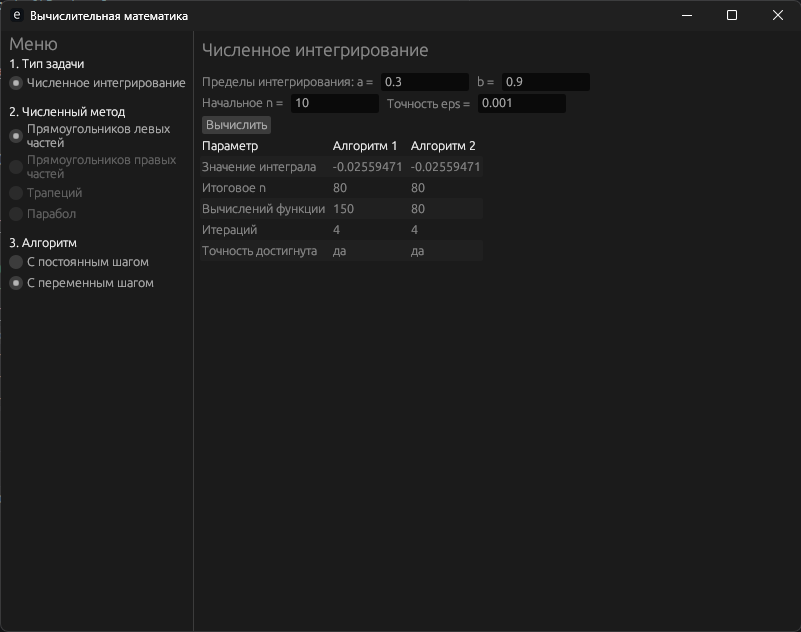

# Numerical Methods

Программа с графическим интерфейсом для лабораторных работ по численным методам. Написана на Rust с [egui](https://github.com/emilk/egui) (eframe), кроссплатформенная, собирается в один исполняемый файл.


## Численное интегрирование

Подынтегральная функция по варианту задания:

$$f(x) = \frac{\cos(0.8x + 1.2)}{1.5 + \sin(x^2 + 0.6)}$$

### С постоянным шагом

Вычисление интеграла на отрезке $[a, b]$ при заданном числе разбиений $n$:

- метод левых прямоугольников
- метод правых прямоугольников
- метод трапеций
- метод парабол (Симпсона)

### С переменным шагом

Метод левых прямоугольников с автоматическим подбором шага под заданную точность $\varepsilon$: число разбиений удваивается, пока разница между соседними приближениями $|I_n - I_{2n}|$ не станет меньше $\varepsilon$.

Реализованы два алгоритма:

| | Алгоритм 1 | Алгоритм 2 |
|---|---|---|
| Идея | На каждом шаге интеграл считается заново | Используется уже накопленная сумма: при удвоении $n$ досчитываются только значения в серединах отрезков |
| Вычислений функции | больше | примерно в 2 раза меньше |

По результату выводятся: значение интеграла, итоговое число разбиений, число итераций, количество вычислений функции и признак того, достигнута ли точность (ограничение — 20 итераций).



## Запуск

```bash
cargo run --release
```

Нужен установленный [Rust](https://rustup.rs).

## Структура

```
src/
├── main.rs          # интерфейс: выбор задачи, метода и алгоритма, ввод параметров, вывод результатов
└── integration.rs   # численные методы
```

Вычисления отделены от интерфейса, а типы задач вынесены в отдельное перечисление — новые разделы курса добавляются как новые модули без переписывания существующих.
